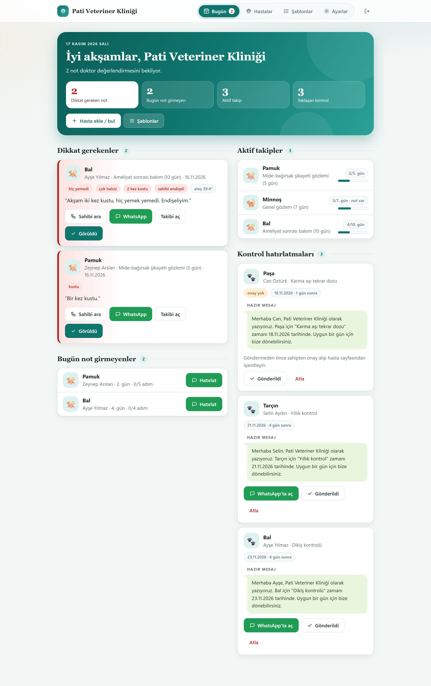
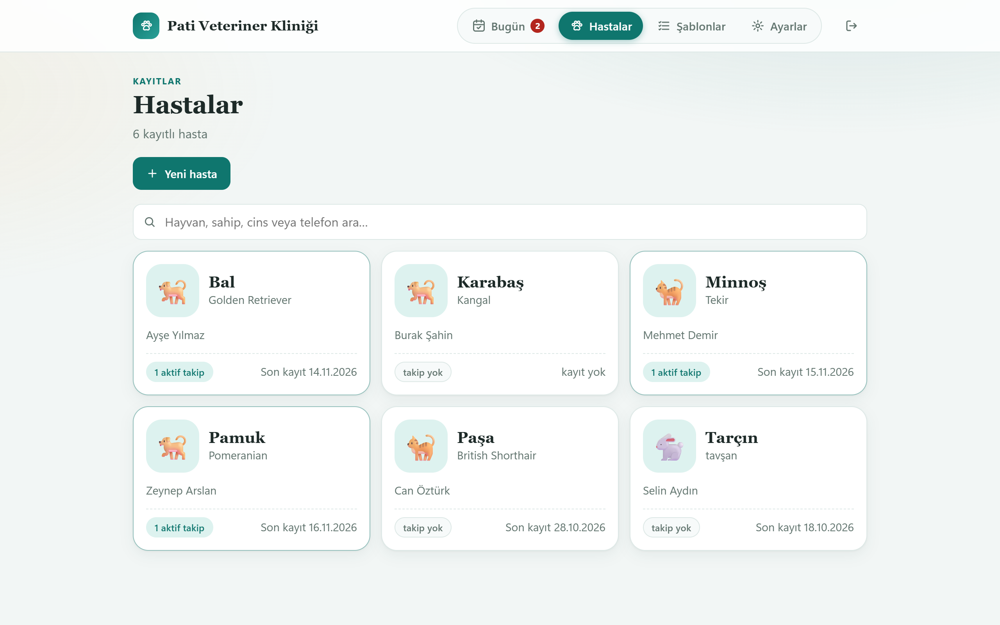
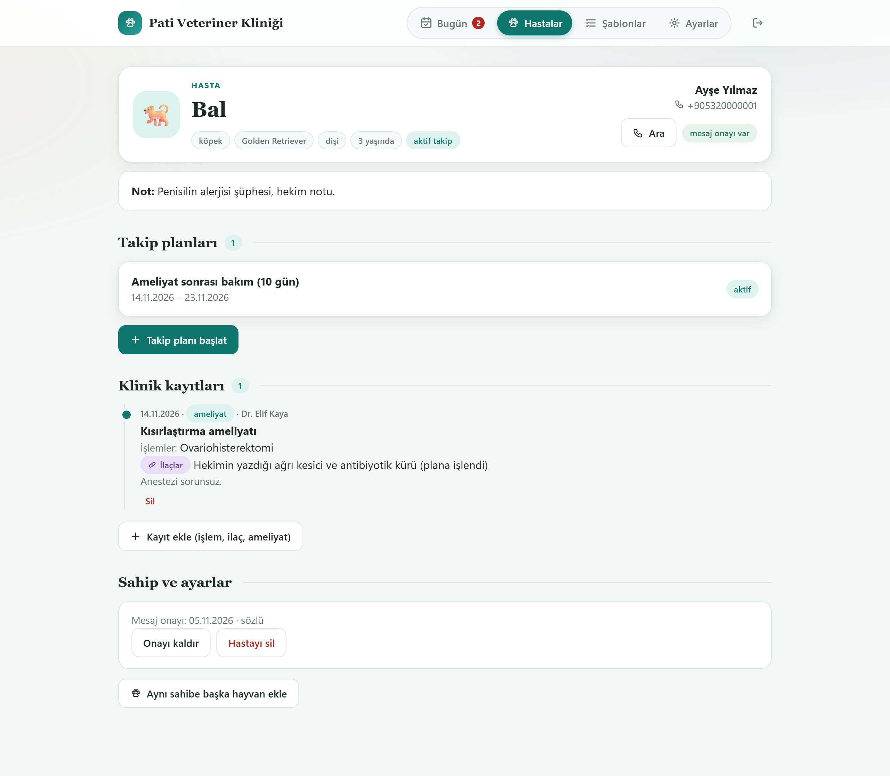
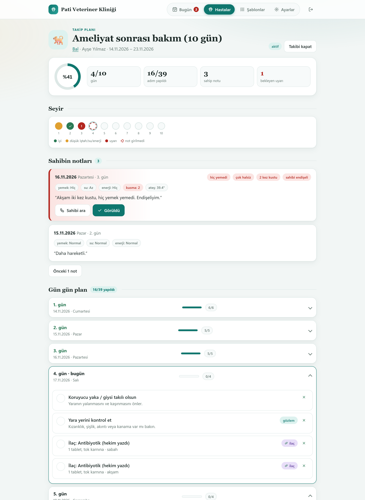
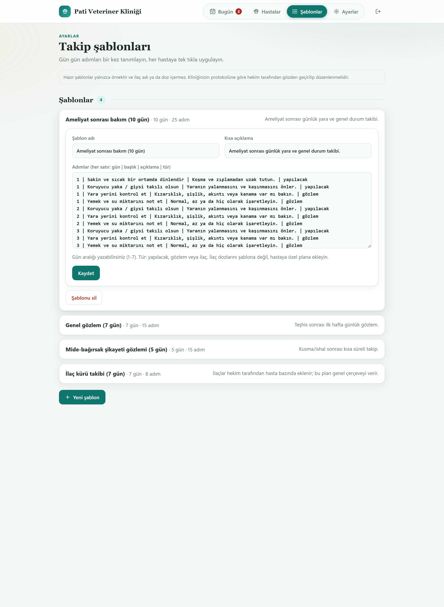
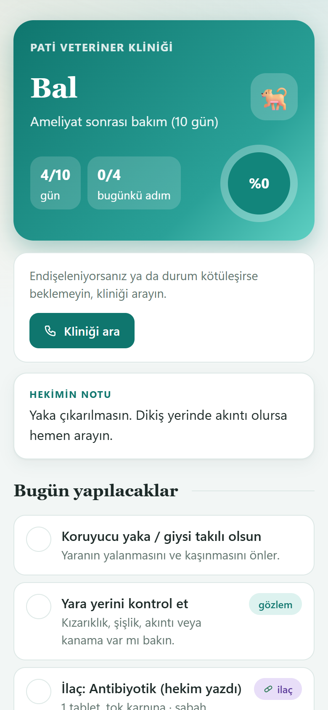
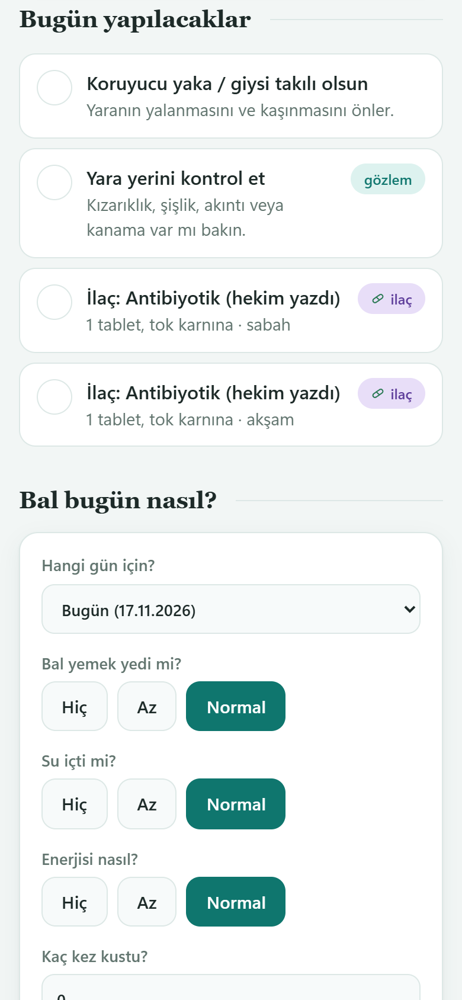
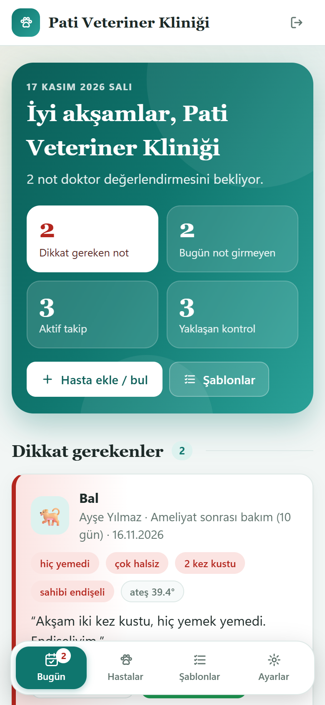
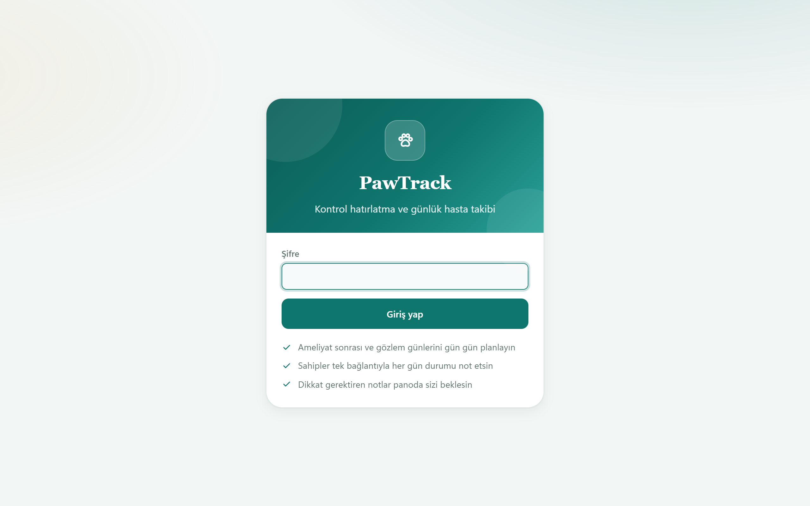
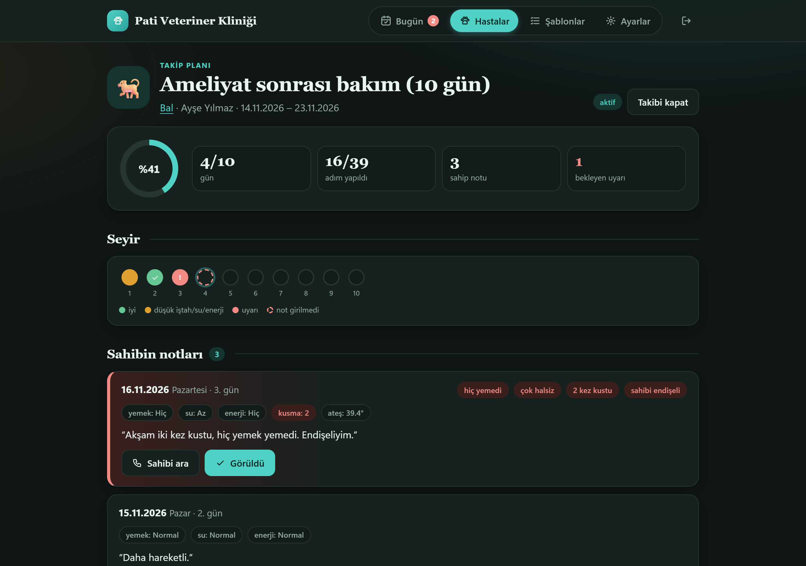

# 🐾 PawTrack

**Control reminders and day-by-day home follow-up for small veterinary clinics.**

After a surgery or during a week of observation, a clinic usually has no idea how the animal is doing at home until something goes wrong. And owners forget control visits and vaccines. PawTrack closes both gaps without adding a heavy system: the vet plans the days, the owner taps a private link and notes how the pet is doing, and the clinic sees **who needs attention today**.

> **Status: working prototype / portfolio project.** Not validated with real clinics. It is a record-keeping and reminder tool: it does not diagnose, suggest drugs or compute doses. All screenshots use fictional demo data.

<p align="center">
  
</p>

## What it does

| For the veterinarian | For the pet owner (no account) |
|---|---|
| Records exams, surgeries, vaccines and treatments with the procedures and medications used | Opens one private link on their phone |
| Starts a **day-by-day care plan** from an editable template ("10 days after surgery", "7 days of observation") | Sees today's tasks and ticks them off |
| Adds the patient's medications: name and dose text as the vet wrote it, spread over days and times of day | Fills a 30-second daily note: appetite, water, energy, vomiting, temperature, free text |
| Sets a control or vaccine reminder date and gets a ready WhatsApp message | Can call the clinic with one tap |
| Sees warning signs, missing notes and the trend of every plan at a glance | Sees the vet's note and their own previous notes |

## A day in the app

1. **Add the patient and owner once.** The owner's message consent is stored with the date and how it was given (verbal, written/WhatsApp, form).
2. **Record the visit** with procedures, medications and, optionally, a reminder date. Upcoming reminders appear on the dashboard with a prepared WhatsApp message.
3. **Start a care plan** from a template, add this patient's medications, and send the owner the private link with the prepared message.
4. **The owner reports daily.** Warning signs (did not eat, did not drink, very lethargic, vomiting, "I'm worried") go to the top of the dashboard and stay there until someone presses **Seen**. Plans with no note today are listed with a one-tap reminder.
5. **Follow the course** on the plan page: a trend strip with one dot per day (good, low appetite/water/energy, warning, no note yet), the owner's notes, and the day cards.

| Patients | Patient record | Care plan |
|---|---|---|
|  |  |  |

| Templates | Owner: today | Owner: daily note | Dashboard on a phone |
|---|---|---|---|
|  |  |  |  |

<details>
<summary>More: login and dark theme</summary>

| Login | Dark theme |
|---|---|
|  |  |

</details>

## Safety by design

- **No medical advice.** The app never suggests, calculates or validates drugs or doses. Starter templates contain no drug names; medication text is exactly what the vet typed.
- **Transparent alerts.** "Needs attention" is a fixed, visible rule (appetite, water or energy at the lowest level, any vomiting, owner ticked "I'm worried"), not a hidden score. The vet decides what it means. Every alert stays until a person marks it as seen.
- **Always a way out.** The owner page has a one-tap **Call the clinic** button and states that it is not medical advice.
- **Minimal exposure.** The owner page shows only the animal, the plan and the owner's own notes. No owner phone, no other patients, not indexed by search engines.
- **Human in the loop.** WhatsApp messages are prepared as `wa.me` links and sent by a person. Nothing is sent automatically, and sending is blocked without recorded consent.
- Starter templates are examples that must be reviewed by a veterinarian before use.

## Feature list

**Clinic**
- Patients and owners, several animals per owner, species-aware avatars
- Clinic records: procedures, medications, vet name, optional reminder date
- Care-plan templates (editable, day ranges like `1-7`), blank plans, one-off steps
- Per-dose medication schedule: 1–4 times a day, up to 60 days, plan extends automatically
- Plan page: completion ring, trend strip, collapsible day cards (today and tomorrow open), owner notes
- Dashboard: greeting hero with live counts, attention list, no-note-today list, control reminders for the next 7 days, plans that ended but are still open, active plans with progress
- Navigation badge with the number of unreviewed warnings
- Consent record per owner, database backup download

**Owner link**
- Tick tasks (future days are locked), daily note with simple scales, temperature validation
- Edit today's note again, back-fill up to 7 days
- Progress ring, large tap targets, light and dark theme

**Platform**
- Single-clinic password login (httpOnly, HMAC-signed cookie), login throttle (5 attempts per address and 25 overall per 15 minutes)
- Clinic-local "today" (Europe/Istanbul by default), so day boundaries do not shift at night
- Responsive layout with a bottom tab bar on phones

## Deliberately not included

- No automatic sending, no AI triage, no dose or drug suggestions
- No multi-clinic accounts, billing, inventory or lab integrations
- No photo or file uploads (health data and storage need a proper review first)

## Tech

Next.js 16 (App Router, Server Actions, Route Handlers), React 19, TypeScript, SQLite through Node's built-in `node:sqlite`, plain CSS. No UI, ORM or date libraries.

```
app/        pages, server actions, styles
  p/[token] owner page (public, token-protected)
  plans/    care plan page      pets/   patients      templates/   settings/
lib/        care.ts     plan expansion, medication schedule, alert rules, template parsing, messages
            dates.ts    clinic-local dates, phone and age helpers
            ratelimit.ts  login throttle
            db.ts       SQLite schema (lazy connection)   planops.ts / plans.ts   queries
scripts/    seed-demo.ts   fictional demo data (refuses to run on the real database)
tests/      logic.test.ts  unit tests for the pure logic
```

The business rules live in dependency-free modules (`care.ts`, `dates.ts`, `ratelimit.ts`) so they can be unit-tested without a database or a browser.

## Getting started

Requires Node 22.5+ (built-in `node:sqlite`).

```bash
npm install
cp .env.example .env.local   # set CLINIC_PASSWORD and SESSION_SECRET
npm run dev
```

Open http://localhost:3000 and sign in with `CLINIC_PASSWORD`. Data lives in `data/clinic.db` (git-ignored).

| Variable | Purpose |
|---|---|
| `CLINIC_PASSWORD` | clinic login password |
| `SESSION_SECRET` | signs the session cookie (use a long random string) |
| `PUBLIC_URL` | optional, base URL used in the links sent to owners |
| `CLINIC_DATA_DIR` | optional, where the database file lives |
| `CLINIC_TZ` | optional, time zone for "today" (default `Europe/Istanbul`) |

```bash
npm test          # unit tests (node:test)
npx tsc --noEmit  # type check
```

### Demo data

To explore with fictional patients, or to regenerate the screenshots, use a separate database:

```bash
CLINIC_DATA_DIR=./data-demo npm run seed:demo
CLINIC_DATA_DIR=./data-demo npm run dev
```

The seed script refuses to run without `CLINIC_DATA_DIR`, so a real database is never touched.

## Before real use

- Have a veterinarian review the templates and the alert rules.
- Owner names and phone numbers are personal data (KVKK in Turkey): get consent, keep the machine and backups private, serve over HTTPS, and define retention and deletion. The consent record is a memory aid, not legal compliance. Commercial messages in Turkey also involve İYS rules (not verified here).
- The login throttle is in memory and resets on restart.
- Owner links are unguessable, but anyone holding a link can read that plan. Share it only with the owner.

## Known limitations

- One clinic, one login, one process. No per-vet accounts or audit log.
- Owners can edit the last 7 days of notes; edits are not versioned.
- Alert rules are intentionally simple and not clinically validated.

## What I would do next

- Pilot with one or two clinics and replace the sample templates with their real protocols.
- Per-vet accounts and an audit trail of who changed what.
- Optional wound photos, with proper consent and storage.
